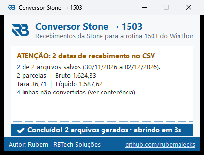

# Conversor Stone → 1503

Converte o **CSV de recebimentos da Stone** para o arquivo de retorno no **padrão 4.1 (layout 1 – SOFTWARE EXPRESS)** que a **rotina 1503 do WinThor** importa para dar baixa nos títulos de cartão.

Um único `.exe` para Windows, sem instalação e sem dependências: arraste o CSV, escolha onde salvar e importe na 1503.



## Download

Baixe o `ConversorStone1503.exe` na página de [Releases](../../releases/latest) e execute. Não precisa instalar nada.

## Como usar

1. No portal da Stone, exporte o relatório de **recebimentos** em CSV.
2. Abra o `ConversorStone1503.exe` e **arraste o CSV** para a janela. Você também pode clicar na área pontilhada para selecionar o arquivo, ou soltar o CSV em cima do ícone do `.exe`.
3. Na janela **Salvar como**, confirme onde salvar. O nome já vem preenchido com a data do recebimento, por exemplo `stone-1503-recebimento-30-11-2026.csv`.
4. Aparece a faixa azul **"✔ Concluído!"** e, depois de 3 segundos, a pasta de destino abre sozinha.
5. Na **rotina 1503** do WinThor, importe o arquivo e faça a baixa.

> Se o CSV tiver **mais de uma data de recebimento**, o programa avisa e gera **um arquivo por data**. Ele pergunta onde salvar cada um. Importe e baixe um arquivo de cada vez.

## O que é convertido

Entra no arquivo da 1503 cada linha do CSV que:

- tenha categoria **Venda**;
- tenha último status **Pago**;
- tenha **Stone ID**;
- seja de uma bandeira com código conhecido (veja a tabela abaixo);
- tenha produto **Crédito** ou **Débito** (pré-pago incluso);
- tenha valor bruto positivo;
- **não** tenha cancelamento do mesmo Stone ID, mesma parcela e mesmo valor.

O resto vai para o arquivo **`<nome-do-csv>-conferencia.csv`**, salvo na mesma pasta. Ele traz o **motivo** de cada linha ter ficado de fora.

Para cada parcela, o programa calcula a taxa (bruto − líquido, incluindo o desconto de antecipação) e o percentual da taxa, e coloca o **Stone ID no campo NSU**. A rotina 1503 encontra o título comparando esse campo com `PCPREST.NSUHOST`.

### Códigos usados (layout de retorno 4.1, Software Express / Fiserv)

| Campo | Valor |
|---|---|
| 16 – Tipo de produto | `C` crédito, `D` débito, `V` voucher (o pré-pago segue o tipo base) |
| 18 – Rede (Tabela I) | `369` = Stone |
| 27 – Bandeira (Tabela II) | veja a tabela abaixo |

**Bandeiras reconhecidas.** É a Tabela II completa, menos os códigos de dinheiro, cheque, TEF e bandeira própria.

| Bandeira | Crédito | Débito | | Bandeira | Crédito | Débito |
|---|---|---|---|---|---|---|
| Amex / American Express | `0001` | `0001` | | Sorocred | `0013` | `0013` |
| Cabal | `0002` | `0002` | | CredSystem | `0014` | `0014` |
| Diners Club | `0003` | `0003` | | UnionPay (CUP) | `0015` | `0015` |
| Elo | `0004` | `0004` | | Banricompras | `0016` | `0016` |
| Hipercard | `0005` | `0005` | | Verdecard | `0017` | `0017` |
| Maestro | `0006` | `0006` | | Agiplan | `0018` | `0018` |
| Mastercard | `0007` | `0007` | | **Banescard** | `0029` | `0019` |
| Visa | `0008` | `0008` | | Esplanada | `0020` | `0020` |
| Visa Electron | `0009` | `0009` | | CredZ | `0021` | `0021` |
| Alelo | `0010` | `0010` | | **Hiper** (≠ Hipercard) | `0031` | `0022` |
| **Siscred** | `0011` | `0012` | | Avista | `0023` | `0023` |
| JCB | `0030` | `0030` | | CRF / Atac / Ourocard | `0024` / `0025` / `0035` | igual |

Uma bandeira que não esteja na tabela vai para a conferência como "Bandeira sem código conhecido". O nome é comparado sem acentos, espaços e maiúsculas, então "American Express", "AmericanExpress" e "AMEX" são reconhecidos. Para incluir um nome novo, acrescente uma linha em `bandeiras`, no `convert.go`.

Fonte: [Return File 4.1](https://docs.apis-fiserv.com/latam/docs/conciliador-retorno-41) e [Code Table](https://docs.apis-fiserv.com/latam/docs/code-table).

### ⚠ Cancelamento de venda já baixada

Se o CSV traz um **cancelamento** cuja venda **não está no mesmo CSV**, a venda provavelmente já foi paga e baixada num período anterior. A Stone desconta esse valor do repasse, normalmente junto com um "Balanceamento de Saldo". O programa:

- mostra o aviso **"⚠ cancelamento(s) de venda já baixada: estornar no WinThor"** na janela;
- coloca essas linhas **no topo da conferência**, com o motivo `ATENÇÃO: ... estornar a baixa no WinThor`.

Nesse caso, o total do arquivo da 1503 fica maior que o valor que de fato caiu na conta. O estorno precisa ser feito à mão no WinThor.

## Antes de usar em outra empresa

O programa **não tem dados de nenhuma empresa gravados no código**: nenhum CNPJ, filial ou conta. O código do estabelecimento (STONECODE) vem do próprio CSV. Mesmo assim, confira estes pontos:

| Ponto | Situação |
|---|---|
| **NSU = Stone ID** | Só dá baixa se os títulos de cartão estiverem gravados no WinThor com o Stone ID em `PCPREST.NSUHOST`. Isso depende da integração PDV/TEF de cada empresa. |
| Bandeiras de débito | O débito sai com produto `D` e o código da bandeira "família" (Visa `0008`, Mastercard `0007`, Elo `0004`). A Tabela II também tem códigos só de débito (Visa Debit `0033`, Master Debit `0032`, Elo Debit `0034`). Se a 1503 da empresa estiver configurada com esses códigos, mude `usarCodigoDebitoProprio` para `true` no `convert.go`. |
| Formato dos valores | O programa espera vírgula decimal (`1.524,33`), que é como a Stone exporta hoje. |

## Compilar

Requer o [Go 1.24+](https://go.dev/dl/).

```powershell
.\build.ps1            # roda go vet + testes e gera dist\ConversorStone1503.exe
.\build.ps1 -SemTestes # só compila
go test ./...          # só os testes
```

O ícone do executável fica em `rsrc_windows_amd64.syso`, gerado a partir de `assets/icone.ico`. Para trocar o ícone, gere um novo `.syso`, por exemplo com o [akavel/rsrc](https://github.com/akavel/rsrc):

```powershell
rsrc -ico assets\icone.ico -o rsrc_windows_amd64.syso
```

Fora do Windows, o mesmo código compila como **linha de comando** (`go run . arquivo.csv`). Útil para testar a conversão: os arquivos são gravados na pasta do CSV.

## Estrutura

```
convert.go               leitura do CSV da Stone e geração do layout 4.1 (sem interface)
convert_test.go          testes da conversão
main_windows.go          janela Win32 (arrastar e soltar, Salvar como, faixa de concluído)
main_other.go            versão linha de comando para outros sistemas
rsrc_windows_amd64.syso  ícone embutido no .exe
assets/icone.ico         ícone original
build.ps1                script de compilação
docs/                    imagens do README
```

## Autor

Rubem · RBTech Soluções — [github.com/rubemalecks](https://github.com/rubemalecks)
